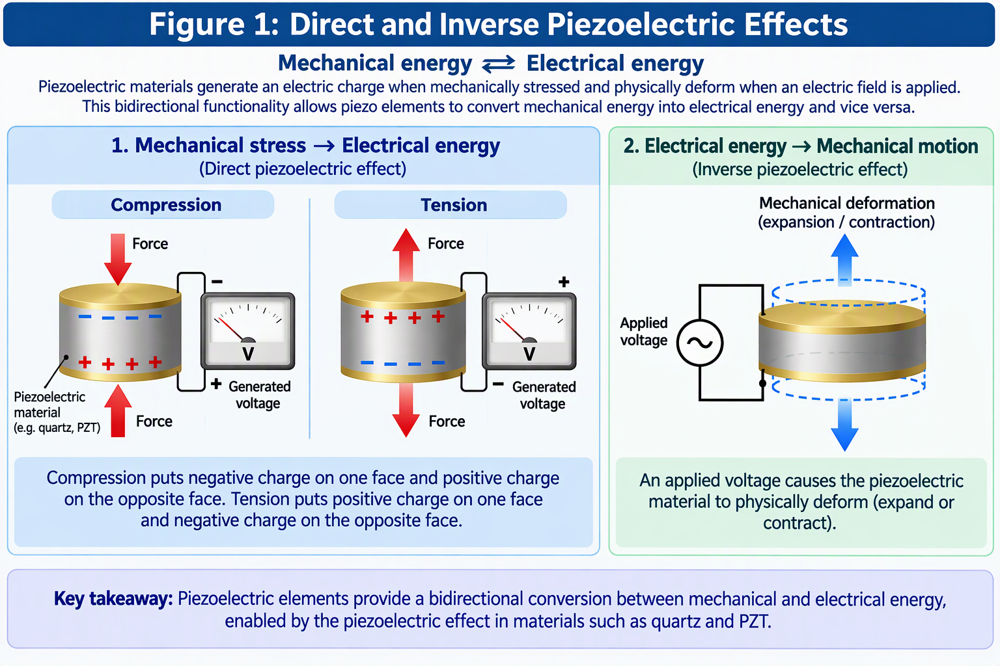
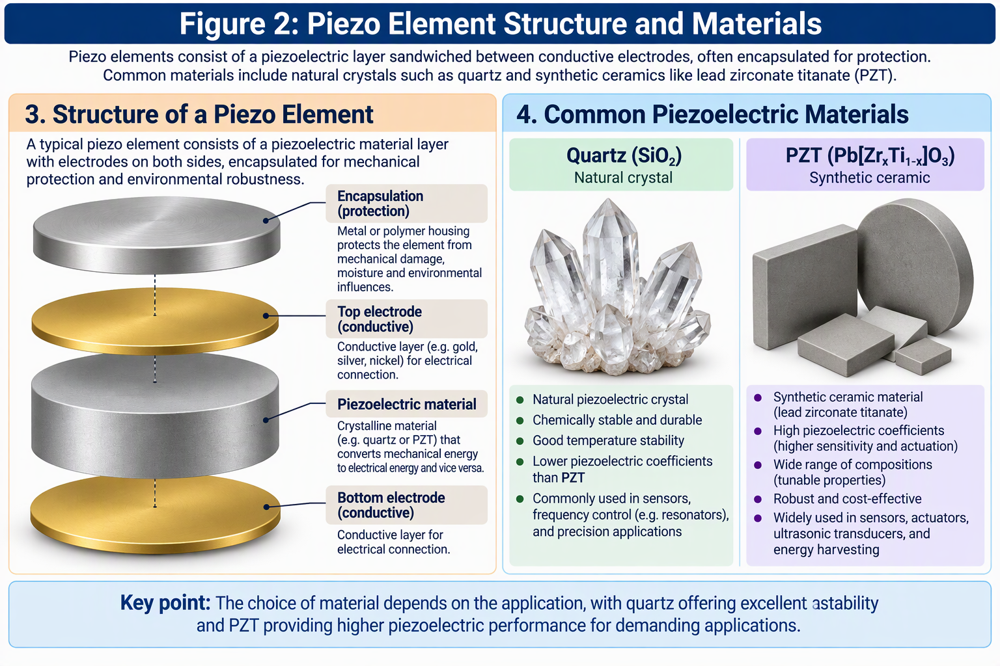
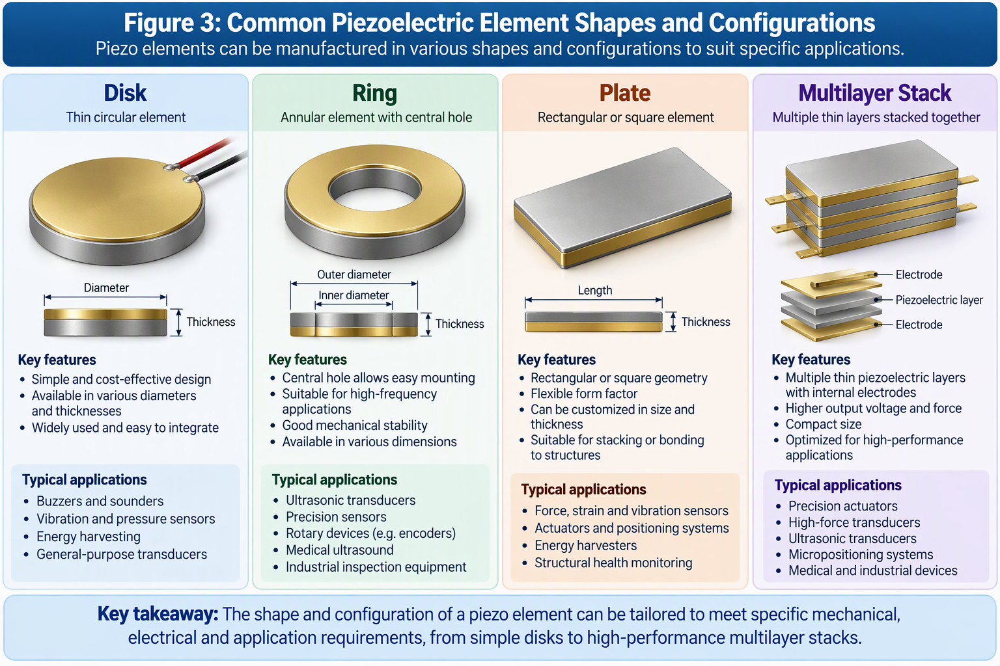

# Piezo element project

## The history and background

Piezo elements are electromechanical transducers made from piezoelectric materials that convert mechanical energy into electrical energy and vice versa.  This bidirectional functionality relies on the [piezoelectric effect](https://en.wikipedia.org/wiki/Piezoelectricity), discovered in 1880 by the [Curie brothers](https://piezo.com/pages/history-of-piezoelectricity), where certain crystalline structures generate an electric charge when mechanically stressed and physically deform when an electric field is applied.  

Common materials used include natural crystals like quartz and synthetic ceramics such as lead zirconate titanate (PZT).  These elements typically consist of a piezoelectric layer sandwiched between conductive electrodes, often encapsulated for protection, and can be shaped as disks, rings, plates, or multilayer stacks to suit specific needs.

## Piezo elements
Piezo elements are available in various geometric shapes, including disks, rings, tubes, plates, spheres, and multilayer stacks, each engineered for specific energy conversion efficiencies.  

Single-plate types typically function as pressure or ultrasonic sensors, while multilayer stacks provide high force with minimal travel for actuators, and benders (bimorphs) offer large deflections for motors and valves.

## Use cases
Key use cases span multiple industries:

### Sensing:  
Detecting pressure, vibration, force, and acceleration in automotive engine knock sensors, industrial machinery monitoring, and smart wearables like fitness bands.

### Actuation & Precision Control:  

Enabling nanometer-level precision in atomic force microscopes, semiconductor lithography, and ultrasonic motors for camera autofocus and inkjet printing.

### Medical & Industrial Ultrasound:  

Generating and receiving sound waves for diagnostic imaging, kidney stone crushing, dental plaque removal, and ultrasonic cleaning or welding. 
### Consumer Electronics:  

Powering buzzers, speakers, microphones, touchpads (e.g., BlackBerry SurePress), and energy harvesting devices that convert foot traffic or machinery vibration into electricity.
### Automotive & Aerospace:  
Driving high-pressure fuel injectors, airbag sensors, and adjusting wing flaps in UAVs for precise flight control.